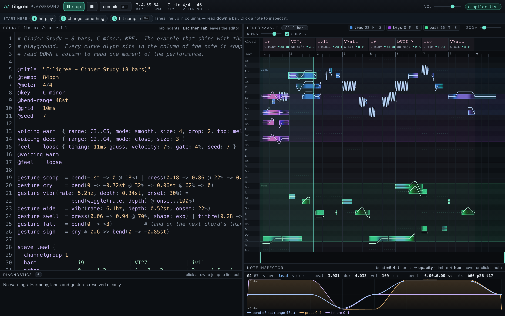
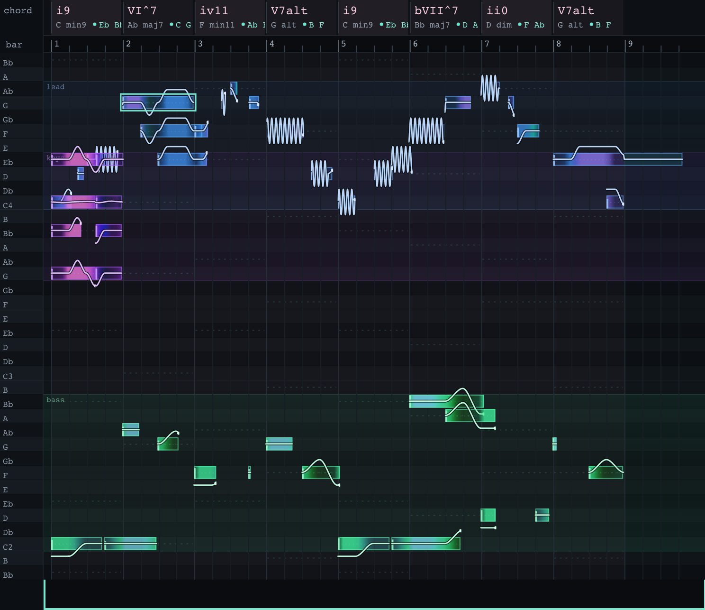
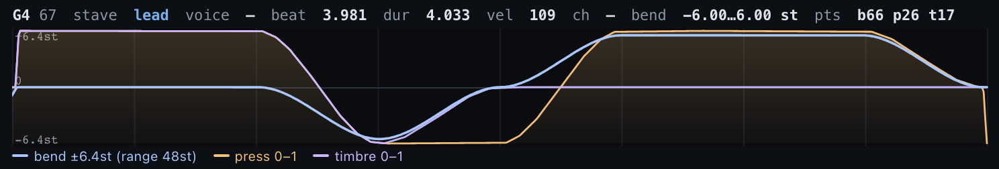
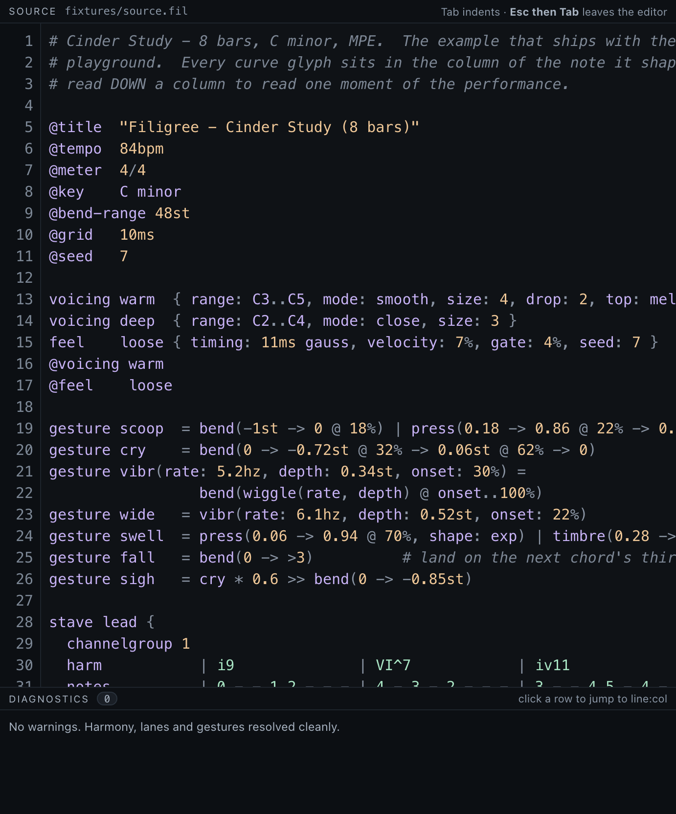
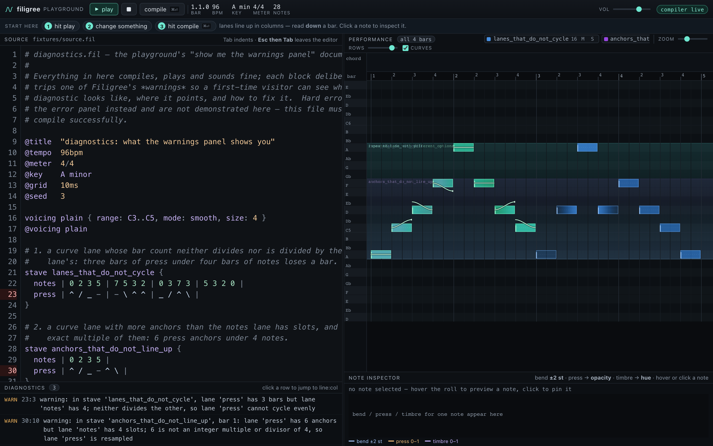

# Filigree

**A text language for composing music that actually moves.**

Filigree is a small language, a compiler, and a browser playground for writing
expressive music as text. It targets **MPE over MIDI 1.0** — every note gets its
own channel, its own pitch bend, its own pressure and timbre — so what you type
arrives in your DAW as per-note expression, not as a flat grid of note-ons.



```
voicing warm = { range: C3..C5, mode: smooth, size: 4, drop: 2, top: melody }
gesture sigh = bend(0 -> -0.45st -> 0, shape: ease)

stave lead {
  harm!voicing=warm | i9       | VI^7     | iv11     | V7alt     |
  notes             | 0 . 2 3  | 4 - - 2  | ~5 4 . 2 | 1 - - -   |
  bend!range=3st    | ___/^^^^ | ^^\_____ | ........ | __/\___>3 |
  press             | /^^^\___ | -----^^^ | __/^^^^^ | ^^^^\___  |
}
```

That block is the file `examples/front_page.fil`; it compiles with no warnings.
Eight glyphs per bar under four notes is deliberate — a curve lane's anchor count
has to be a multiple or divisor of the bar's note count, and `.` means "no data
here", which is why bar 3's bend lane is dots rather than blank.

Read that bottom-up: the `notes` lane plays scale degrees over the chords in the
`harm` lane above it, and the `bend` and `press` lanes are **drawn** underneath,
column-aligned with the notes. `>3` at the end of bar 4 does not mean "bend up
two semitones" — it means *glide into the third of the next chord*, whatever that
turns out to be after you change the progression.

---

## Contents

- [Why this exists](#why-this-exists)
- [What it looks like running](#what-it-looks-like-running)
- [Install](#install) ← **start here**
- [Verify the install](#verify-the-install)
- [Optional: live MIDI output](#optional-live-midi-output)
- [First sound, in three commands](#first-sound-in-three-commands)
- [Getting MPE into a DAW](#getting-mpe-into-a-daw)
- [Commands](#commands)
- [Troubleshooting](#troubleshooting)
- [Known limits](#known-limits)
- [Learn the language](#learn-the-language)
- [Repository layout](#repository-layout)
- [Tests](#tests)
- [How this was built: the Gauntlet Loop](#how-this-was-built-the-gauntlet-loop)
- [Sources](#sources)
- [Licence](#licence)

---

## Why this exists

Every text-music tool makes expression an afterthought. Sequencers give you
per-note automation but only by mouse. Live-coding languages give you terse
patterns but treat vibrato as a global effect or a parameter ramp. Notation
languages describe a bend as an ornament, not as data.

Filigree closes five specific gaps:

1. **Expression is a note-scoped, typed, time-normalised curve.** Not a track
   automation lane that happens to overlap a note — a value that belongs to the
   note and is defined over its own 0..1 lifetime, so it survives when you change
   the note's length.
2. **Curves are drawn as ASCII, column-aligned with the notes.** You see the
   phrase's shape in the same place you read its pitches.
3. **Curve endpoints can be harmony-aware.** `>3` glides into the next chord's
   third; `>5`, `>7`, `>root` likewise. Re-harmonise and the gestures follow.
4. **Voices are named and individually expressive**, mapped onto MPE per-note
   channels — `@bass`, `@melody` can each carry their own lanes.
5. **Gestures are first-class composable values** with an algebra: `+` layers,
   `*` scales, `>>` sequences, `|` parallels lanes, `@ 40%..100%` restricts a
   gesture to part of a note.

Timing is **slot-inferred**, tracker style: the number of items you type in a bar
sets that bar's subdivision. That is what makes the column alignment possible at
all — you never write durations, so a bar's lanes share one time frame no matter
how many items each contains. That is not the same as being *automatically*
aligned: a curve lane may carry more anchors than the bar has notes (that is how
you draw a shape finer than the rhythm), and when the two counts are not an exact
multiple or divisor of each other, the curve is resampled and the compiler warns,
naming both counts and the line and column to look at. The alignment you see in
the text is your own doing; the compiler's job is to tell you the moment it stops
being true.

---

## What it looks like running

The playground is served by the standard library — no build step, no npm, no
dependencies. `filigree serve` and open a browser.

**The piano roll draws each note's expression inside the note**, so you read the
performance and not just the pitches. Bend is the white line, pressure is the
note's opacity, timbre is its hue:



Click any note and the inspector plots its three curves against its own lifetime,
with the resolved bend range in semitones:



The source pane highlights lanes in the colour of the stave they belong to, so
the columns stay readable as a file grows:



Diagnostics point at a line and column and say what to do about it. Warnings never
stop the music — the file still compiles and plays:



---

## Install

### Requirements

| | |
|---|---|
| **Python** | 3.11 or newer (developed and tested on 3.14) |
| **OS** | macOS, Linux or Windows |
| **Required packages** | `numpy`, `mido` — installed for you by the step below |
| **Optional** | `python-rtmidi`, only for live MIDI output. See [below](#optional-live-midi-output). |
| **Browser playground** | no dependencies, no build step |

You do **not** need Node, npm, a C compiler, or a DAW to compile files, render
`.mid` and use the playground. A compiler is only needed for the optional live
MIDI extra, and only on some platforms.

### Step 1 — get the code

```bash
git clone https://github.com/mark-renker/filigree.git
cd filigree
```

### Step 2 — make a virtual environment

Do this rather than installing into your system Python. On many systems the
system Python has no `numpy`, and on recent macOS and Debian/Ubuntu, `pip` will
refuse to install into it at all (`error: externally-managed-environment`).

```bash
python3 -m venv .venv
source .venv/bin/activate          # Windows: .venv\Scripts\activate
```

Your prompt should now be prefixed with `(.venv)`. Confirm you are pointed at the
right interpreter — this should print a path *inside* the project:

```bash
python -c "import sys; print(sys.executable)"
# .../filigree/.venv/bin/python
```

> **You must re-run `source .venv/bin/activate` in every new terminal.** If the
> `filigree` command "disappears" later, this is almost always why.

### Step 3 — install

```bash
pip install -e .
```

That pulls `numpy` and `mido` and puts a `filigree` command on your PATH. The
`-e` (editable) install means edits to `src/filigree/` take effect immediately,
with no reinstall.

### Step 4 — check it worked

```bash
filigree --version
filigree render examples/nocturne.fil -o nocturne.mid
```

The first prints the version (`0.1.0`). The second should print:

```
wrote nocturne.mid  (25 notes, 16.22 beats, 2 stave(s), MPE lower zone)
```

If `filigree: command not found`, your virtual environment is not active — go
back to step 2. You can always bypass the PATH entirely:

```bash
python -m filigree.cli --version
```

---

## Verify the install

Optional, but it takes twenty seconds and tells you the whole toolchain is sound
on your machine rather than just importable:

```bash
pip install -e ".[dev]"
python -m pytest
```

The suite is **859 tests**, and you should see something like
`858 passed, 1 skipped`. Nothing should fail. Two of the tests are conditional on
your environment, so exactly which one skips depends on your setup: one exercises
the *missing*-`python-rtmidi` path and therefore skips once you install the
realtime extra, and one needs the MAESTRO reference corpus, which is not
redistributed here and so is absent on a fresh clone (see [NOTICE.md](NOTICE.md)).

The suite is not only unit tests: it audits MPE output
against RP-053, checks harmony against music-theory ground truth, verifies the
playground's curve overlay aligns with the piano roll to sub-pixel tolerance, and
compiles **every fenced code block in this README and in `docs/SPEC.md`**,
requiring zero warnings — so the documentation cannot drift from the language.

You can also run the standalone MPE conformance audit. With no argument it
renders and audits its own fixture, which exercises the full checklist:

```bash
python tools/audit_mpe.py
# ...
# 26 checks, 0 failures
```

Point it at a file you rendered and it audits that instead. The number of checks
varies with what the file actually contains — `nocturne.mid` reports
`25 checks, 0 failures` — but any failure is a real conformance defect:

```bash
python tools/audit_mpe.py nocturne.mid
```

---

## Optional: live MIDI output

Everything above works without this. You only need it for the two commands that
talk to a MIDI port in real time — `filigree play`, `filigree watch` and
`filigree ports`. Rendering a `.mid` file does not.

```bash
pip install -e ".[realtime]"
```

### If that fails on macOS with `sem_timedwait`

This is the one install problem worth documenting in full, because the error
names the wrong culprit.

```
error: use of undeclared identifier 'sem_timedwait'
```

**The cause is JACK.** If JACK is installed on your Mac (`brew install jack`,
QjackCtl, or anything that dropped a `jack` pkg-config file), `python-rtmidi`
detects it and compiles RtMidi's JACK backend. That backend calls
`sem_timedwait`, a POSIX function macOS does not implement, and the build dies.
It has nothing to do with your Python version.

Build it CoreMIDI-only instead — which is all macOS needs anyway:

```bash
pip install python-rtmidi --no-binary python-rtmidi \
  --config-settings=setup-args="-Djack=false"
```

Then confirm the backend is live:

```bash
python -c "import rtmidi; print([rtmidi.get_api_name(a) for a in rtmidi.get_compiled_api()])"
# ['core']
```

### Platform notes

- **macOS, Python 3.13+** — `python-rtmidi` publishes wheels only up to CPython
  3.12, so newer versions build from source. You will need the Xcode command line
  tools (`xcode-select --install`). This is also what exposes the JACK trap above.
- **Linux** — `sem_timedwait` exists, so JACK is not a problem; a JACK or ALSA
  backend is what you want. Install headers first if the build complains:
  `sudo apt install libasound2-dev libjack-jackd2-dev`.
- **Windows** — wheels are published; `pip install -e ".[realtime]"` should just
  work, using the WinMM backend.

---

## First sound, in three commands

```bash
# 1. see what the compiler understands — harmony, voicings, where each bend lands
filigree explain examples/nocturne.fil

# 2. write a standard MIDI file with full MPE expression
filigree render examples/nocturne.fil -o nocturne.mid

# 3. open the playground: edit, hear it in the browser, watch the curves
filigree serve
#   -> http://localhost:8787
```

`explain` is the one to reach for when something sounds wrong. It prints the
resolved chord for every bar, then every note with its pitch, velocity, voice and
the actual range each curve covers — including where a `>` target landed:

```
front page   84 bpm  4/4  key=C minor  mpe-bend=±48st  seed=7

stave 'lead'  (9 notes)
  harmony:
    bar 1.00  i9         min9       [C Eb G Bb D]  guide[Eb Bb]  voiced[Eb3 Bb3 D4 C5]
    bar 4.00  V7alt      alt        [G B F Ab Bb C# Eb]  guide[B F]  voiced[Eb3 F3 B3 D4]
  notes:
       beat    dur pitch name  vel voice    lanes  (bend shows where the note lands)
      0.000  1.000    60 C4     90 -        bend[+0.00..+0.00×2]→C4(+0.00st) press[+0.00..+1.00×8]
     12.000  4.000    62 D4     90 -        bend[-3.00..+2.99×49]→B3(-3.00st) press[+0.00..+1.00×10]
```

In the playground, hit **play**, change a glyph in the source pane, and hit
**compile** (⌘↵ / Ctrl↵). While you are sketching, add `--lenient` on the command
line so a half-typed file still plays.

---

## Getting MPE into a DAW

### The easy way: render a file

```bash
filigree render examples/nocturne.fil -o nocturne.mid
```

The `.mid` is a type-1 SMF at 960 PPQN, MPE over MIDI 1.0, with a proper lower
zone configuration message at the top. Drag it onto an MPE-capable instrument
track — Bitwig, Ableton 11+, Logic 10.7+, Cubase, or a plugin like Equator,
Pigments or Surge XT — and the per-note bends, pressure and CC74 arrive with the
notes. Nothing to configure.

### Playing live

You need a virtual MIDI cable between Filigree and your DAW.

**macOS.** Open **Audio MIDI Setup** → *Window ▸ Show MIDI Studio* → double-click
**IAC Driver** → tick **Device is online**, and add a port if the list is empty.
This is off by default on a clean macOS install and cannot be enabled from the
command line.

**Windows.** Install [loopMIDI](https://www.tobias-erichsen.de/software/loopmidi.html)
and create a port.

**Linux.** Use the ALSA virtual MIDI (`sudo modprobe snd-virmidi`) or JACK.

Then:

```bash
filigree ports
filigree play examples/nocturne.fil --port "IAC Driver Bus 1"
```

In your DAW, set the track input to that port and enable MPE on the instrument.
Filigree configures the MPE lower zone on connect — master channel 1, members
2–16, ±48 semitone member bend range — per MIDI Association RP-053.

`filigree watch <file> --port "IAC Driver Bus 1"` re-renders and replays every
time you save the file.

> **If `filigree ports` prints "no MIDI output ports found"** and tells you to
> enable the IAC Driver, check first that `python-rtmidi` is actually installed.
> Without it the message is the same, but the real cause is the missing backend.
> `python -c "import rtmidi"` settles it in one second.

---

## Commands

| Command | What it does |
|---|---|
| `filigree render FILE [-o OUT]` | compile to a type-1 SMF at 960 PPQN with MPE |
| `filigree play FILE --port P` | play live to a MIDI port |
| `filigree watch FILE --port P` | re-render and replay on every save |
| `filigree explain FILE` | print resolved harmony, voicings, and every note's curves and bend landing |
| `filigree json FILE` | the playground's score schema, for your own tools |
| `filigree serve [--port N]` | run the browser playground |
| `filigree ports` | list MIDI output ports |
| `filigree new FILE` | write a starter file |

Add `--lenient` to `render`/`json`/`explain` while you are sketching. It downgrades
the recoverable token-level errors to warnings and substitutes something inert, so a
half-typed file still compiles and plays:

| Mistake | Strict | `--lenient` |
|---|---|---|
| unknown chord symbol (`Hm7`) | error, exit 2 | warning; sustains the previous chord |
| malformed pitch set (`{0 3 zz}`) | error, exit 2 | warning; drops the bad member |
| unknown curve glyph (`_Q_`) | error, exit 2 | warning; that slot carries no curve data |

Structural mistakes — an unclosed `{`, a lane with no name — stay hard errors in
both modes, because there is nothing sensible to substitute for them.

---

## Troubleshooting

| Symptom | Cause and fix |
|---|---|
| `filigree: command not found` | The virtualenv is not active. `source .venv/bin/activate`. Or run `python -m filigree.cli`. |
| `ModuleNotFoundError: No module named 'numpy'` | You are on your system Python, not the venv. See install step 2. |
| `error: externally-managed-environment` | pip refusing to touch a system Python. Use the venv; do not pass `--break-system-packages`. |
| `error: use of undeclared identifier 'sem_timedwait'` | JACK is installed and macOS lacks that call. Build CoreMIDI-only — see [above](#if-that-fails-on-macos-with-sem_timedwait). |
| `filigree ports` prints nothing / "no MIDI output ports found" | Either `python-rtmidi` is missing, or no virtual MIDI port exists yet. Check `python -c "import rtmidi"` first, then enable the IAC Driver / loopMIDI. |
| `Address already in use` on `filigree serve` | Another copy is running. `filigree serve --port 8788`, or stop the first. |
| Playground loads but is silent | The browser needs a user gesture before it will start audio. Click **play** in the page rather than autoplaying. |
| A lane "loses" bars, or a curve looks resampled | The lane's bar or anchor count does not divide evenly into the notes lane. The warning names both counts and the line:col. |
| Notes play but with no expression in the DAW | The instrument is not in MPE mode, or the track is on a single channel. Enable MPE on the instrument. |

---

## Known limits

Written down so you do not discover them the hard way:

- A lane must be a single line; there is no continuation syntax.
- `[: :8]` repeat blocks do not expand bars reliably.
- Note-lane anchors are `@root`, `@guide`, `@high`, `@low` only.
- `>` harmonic targets are valid on `bend` lanes only.
- Three examples (`blue_iron`, `gesture_algebra`, `reference`) emit render-stage
  advisories about MPE expression-rate thinning. All eight examples compile with
  zero *compile*-stage warnings; these come later, from the MPE renderer, and are
  informational.
- Two `feel` statistics still miss their target intervals and are disclosed in
  `NOTES_P5.md` rather than quietly dropped: the rubato is smoother than a
  human's.

---

## Learn the language

- **[`docs/SPEC.md`](docs/SPEC.md)** — the full language specification: directives,
  staves and lanes, harmony symbols (roman numerals, modal interchange letters,
  absolute chords, raw pitch sets), note tokens, voices, the curve glyph table,
  the gesture algebra, feel, parts, and the error catalogue.
- **[`docs/ARCH.md`](docs/ARCH.md)** — the architecture contract and module
  boundaries.
- **`examples/reference.fil`** — every feature, annotated, in one file.
- **`examples/`** — `nocturne` (expression), `blue_iron` (voices + gestures),
  `pulse` (rhythm and feel), `dorian_drift` (modal interchange),
  `gesture_algebra` (composition operators), `tasks` (the six benchmark tasks).

A good reading order once it is running:

```bash
filigree explain examples/front_page.fil      # what the compiler decided, and why
filigree explain examples/blue_iron.fil       # harmonic bend targets doing real work
filigree explain examples/gesture_algebra.fil # gestures composed with + - * >> | @window
```

---

## Repository layout

| Path | What |
|---|---|
| `src/filigree/` | the compiler: `lex → parse → theory/voicing → gesture → feel → resolve → mpe/realtime` |
| `web/` | the playground — plain JS, no build step, served by `src/filigree/server.py` |
| `examples/` | 8 example pieces |
| `docs/SPEC.md` | the language, normatively |
| `docs/ARCH.md` | module boundaries and the frozen contracts between them |
| `tests/` | 859 tests |
| `tools/` | the MPE audit, the SMF parser, the performance statistics, the plotters |
| `refs/` | the benchmark corpus, critic verdicts, MPE conformance audit, provenance |
| `research/` | the landscape survey and the MPE technical notes this was designed from |
| `status/gauntlet-status.html` | the build record — every round, every verdict, with reasons |
| `NOTES_P*.md` | per-component build notes, including what went wrong |

---

## Tests

```bash
source .venv/bin/activate
pip install -e ".[dev]"

python -m pytest                            # full suite
python tools/audit_mpe.py out.mid           # MPE conformance audit of a rendered file
python tools/gauntlet_status.py             # regenerate the status page
```

---

## How this was built: the Gauntlet Loop

This project was built under an adversarial process, and its record is part of
the deliverable. Every component was built against a **named, fetchable quality
bar** (`refs/BAR.md`) — real MPE conformance documents, real rival-language
solutions to the same six tasks, real piano-performance statistics from the
MAESTRO dataset. Each builder was then judged by an **independent critic with
fresh eyes** who had to make a *forced blind pick* between this work and the
reference, and could only cite evidence it had reproduced itself.

Where the critic picked the reference, the verdict was recorded as a loss and the
component was rebuilt. Several of those losses are still recorded as losses:

- `refs/verdicts/` — the critics' reports, verbatim, including the ones that hurt.
- `status/gauntlet-status.html` — the ledger of every round: piece, verdict,
  reason, evidence. Regenerate with `python tools/gauntlet_status.py`.
- `refs/syntax/tasks.md` — the six benchmark tasks solved in TidalCycles, Strudel,
  Sonic Pi, Alda, Ziffers and LilyPond, with character counts, plus a generated
  **scoreboard** comparing Filigree's own solutions (`refs/syntax/filigree/T*.fil`)
  against the strongest rival on each task. Measured result, not a claim:
  **Filigree is shorter on 2 of the 6 tasks and longer on 4.** It wins where the
  task needs per-note expression (T3, T4) and loses where a rival has a dedicated
  one-liner for exactly that task (T1, T2, T5, T6). Regenerate with
  `python refs/syntax/score_filigree.py --write`; a solution only scores if it
  compiles with zero warnings.

Some of the honest bad news that process produced, written down rather than hidden:

- An earlier draft of this README claimed Filigree was more concise on four of six
  benchmark tasks. A critic caught it; the number is now **generated** from
  compile-checked files, and it is 2 of 6.
- The feel engine's first humanisation pass was statistically wrong — memoryless
  velocity, Gaussian timing, no metrical accent — and was rebuilt against real
  performance-MIDI statistics.
- The parser had a bug where repeating a lane inside a stave silently discarded
  bars. It was found because an 8-bar fixture compiled to 4 bars. Fixed, with a
  test.
- Four written rulings turned out to contradict the code; the code won, and the
  spec now documents what actually happens. See `refs/RULINGS_R3.md`.

---

## Sources

Standards and datasets this implementation is measured against:

- MPE specification RP-053 — <https://midimpe.neocities.org/rp53spec.pdf>
- MIDI Association, MPE overview — <https://midi.org/mpe-midi-polyphonic-expression>
- Bitwig Studio 5.2.5 release notes (MPE behaviour) — <https://www.bitwig.com/dl/Bitwig%20Studio/5.2.5/release_notes/>
- Ableton Live MPE zone configuration — <https://help.ableton.com/hc/en-us/articles/4409113250322-MPE-Zone-Configuration>
- MAESTRO v3 piano performance dataset, used for the `feel` timing/velocity
  distributions — <https://magenta.tensorflow.org/datasets/maestro> (CC BY-NC-SA 4.0;
  per-file attribution in `refs/midi/SOURCES.md`, and see [NOTICE.md](NOTICE.md))
- Rival languages compared in `refs/syntax/`: Strudel <https://strudel.cc/>,
  Sonic Pi <https://sonic-pi.net/tutorial.html>, Alda <https://alda.io/tutorial/>,
  Ziffers <https://github.com/amiika/ziffers/wiki/Chords>, MusicXML `<bend>`
  <https://www.w3.org/2021/06/musicxml40/musicxml-reference/elements/bend/>

## Licence

MIT — see [LICENSE](LICENSE).

Third-party material is called out in [NOTICE.md](NOTICE.md). In short: the
MAESTRO performance excerpts the `feel` engine was calibrated against are
CC BY-NC-SA 4.0 and are **not** redistributed here; `refs/midi/SOURCES.md` tells
you how to fetch them.
